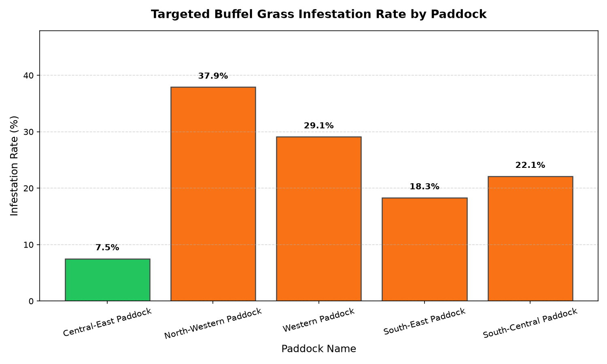
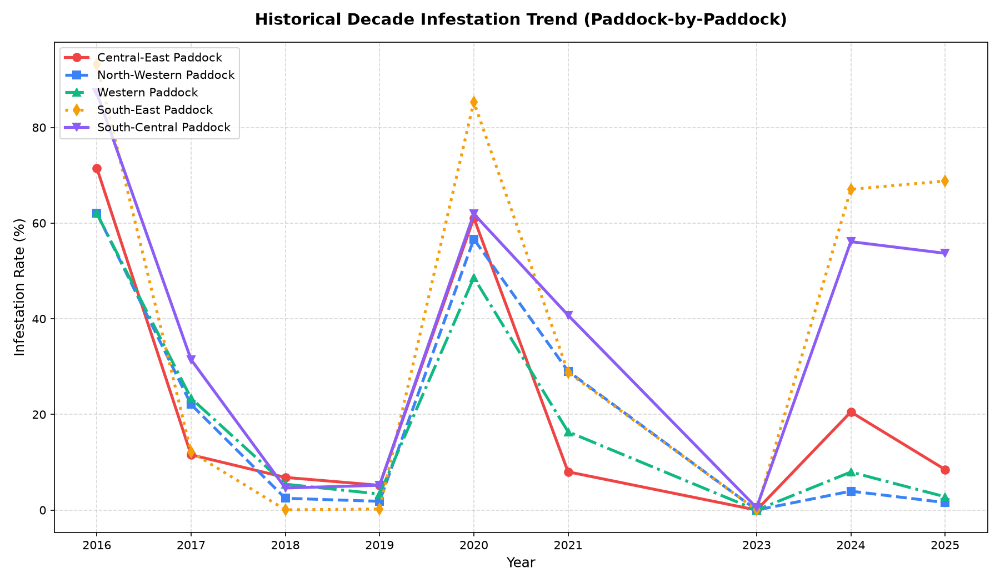

# Buffel Mapper (`buffel-mapper`)

> **Automated Multi-Temporal Sentinel-2 Remote Sensing & 3-Tier Weed Management Pipeline for Buffel Grass (*Cenchrus ciliaris*)**

[](wiki/Home.md)
[](wiki/01-Ecology-and-Remote-Sensing-Methodology.md)
[](wiki/02-Pipeline-Architecture-and-CLI-Reference.md)
[](wiki/03-Compilation-and-Deployment-Guide.md)
[](wiki/04-Field-Validation-and-Calibration-Protocol.md)

---

## Wiki Navigation
* **[Home](wiki/Home.md)** — Overview & Quick Links
* **[01. Ecology & Remote Sensing Methodology](wiki/01-Ecology-and-Remote-Sensing-Methodology.md)** — Warm-Season $\text{C}_4$ Rain-Pulse Clustering, Spectral Indices ($\text{MSAVI}$, $\text{NDRE}$, $\text{NDWI}$), and 3-Tier Decision Rules
* **[02. Pipeline Architecture & CLI Reference](wiki/02-Pipeline-Architecture-and-CLI-Reference.md)** — Module Architecture, Subcommands, and Output File Specifications
* **[03. Compilation & Deployment Guide](wiki/03-Compilation-and-Deployment-Guide.md)** — Building the Standalone Linux Binary (`dist/buffel-mapper`)
* **[04. Field Validation & Calibration Protocol](wiki/04-Field-Validation-and-Calibration-Protocol.md)** — Ground-Truthing Survey Schema & Threshold Optimization

---

## 1. Executive Summary

**Buffel grass (*Cenchrus ciliaris*)** is an aggressive, drought-tolerant $\text{C}_4$ perennial grass that transforms arid and semi-arid ecosystems by outcompeting native flora and fueling high-intensity wildfires ($>800^\circ\text{C}$). In single-date satellite imagery, Buffel grass is nearly impossible to separate from native pasture or woodland.

**`buffel-mapper`** solves this by exploiting the plant's distinct phenological "tells" across a 10-year archive of 10-meter **Sentinel-2 Level-2A** satellite imagery paired with **Bureau of Meteorology (BoM)** rainfall records:
1. **Warm-Season Rain-Pulse Clustering:** Groups warm-season rainfall events ($\ge 15\text{ mm}$, October–April) into 14-day rain pulses and measures the pre-rain vs. post-rain change in **MSAVI** (Modified Soil-Adjusted Vegetation Index).
2. **90th-Percentile Growth Spike & Response Frequency:** Captures peak vegetative vigor while rejecting single-scene cloud halo artifacts (buffered via 2-pixel `SCL` morphological dilation).
3. **Dry-Season Evergreen Refugia Separation:** Evaluates dry-season (August–November) **MSAVI**, **NDRE** (Red-Edge chlorophyll), and **NDWI** (SWIR leaf moisture) alongside dry-season senescence ($\min \text{MSAVI} < 0.22$) to separate dormant/cured grass from native evergreen woodland (**Tier 3 Refugia**).

---

## 2. Example Outputs (Keewong Property Benchmark)

### A. Targeted Warm-Season Rain-Pulse Analysis
Measures the **90th-Percentile Growth Spike** (left) and **Growth Response Frequency** across 48 warm-season rain-pulse clusters (right):


---

### B. 3-Tier Operational Weed Management Layer
Classifies every $10\text{ m} \times 10\text{ m}$ pixel into an actionable management tier:
* **Tier 1 – Eradication (Green):** Light/scattered infestations and advancing invasion fronts ($285.3\text{ ha}$, $20.1\%$) — *Target for priority spot-spraying.*
* **Tier 2 – Containment (Red):** Dense, established core monocultures ($327.9\text{ ha}$, $23.1\%$) — *Target for boundary containment and fire-break management.*
* **Tier 3 – Native Refugia (Cyan):** Stable evergreen tree and shrub canopies ($122.3\text{ ha}$, $8.6\%$) — *Target for ecological protection from grass-fueled fire.*


---

### C. Paddock-by-Paddock Breakdown & 10-Year Invasion Spread
| Paddock Name | Buffered Area (ha) | Tier 1: Eradication | Tier 2: Containment (Core) | Tier 3: Native Refugia | Total Active Weed (T1 + T2) |
| :--- | :---: | :---: | :---: | :---: | :---: |
| **Central-East Paddock** | 477.6 ha | 80.3 ha (16.8%) | 35.7 ha (7.5%) | 42.2 ha (8.8%) | **116.0 ha (24.3%)** |
| **North-Western Paddock** | 423.6 ha | 79.5 ha (18.8%) | 160.5 ha (37.9%) | 36.9 ha (8.7%) | **240.0 ha (56.7%)** |
| **Western Paddock** | 320.5 ha | 58.8 ha (18.3%) | 93.2 ha (29.1%) | 27.6 ha (8.6%) | **151.9 ha (47.4%)** |
| **South-East Paddock** | 113.1 ha | 48.2 ha (42.6%) | 20.7 ha (18.3%) | 6.2 ha (5.4%) | **68.9 ha (60.9%)** |
| **South-Central Paddock** | 81.4 ha | 18.5 ha (22.8%) | 17.9 ha (22.0%) | 9.4 ha (11.6%) | **36.4 ha (44.8%)** |

| Paddock Comparison Chart | Decade Historical Trend |
| :---: | :---: |
|  |  |

#### Decade Invasion Centroid Vectors (2016–2025)


---

## 3. Quickstart: Installation & Linux Compilation

### Option A: Compile to a Standalone Linux Binary (`dist/buffel-mapper`)
Run the included build script to compile the entire workflow (including `GDAL`, `PROJ`, `rasterio`, and `geopandas`) into a single Linux executable:

```bash
chmod +x build_executable.sh
./build_executable.sh
```

Run the compiled executable directly:
```bash
./dist/buffel-mapper run \
  --boundary /path/to/BSA.shp \
  --rain /path/to/rain_data.txt \
  --project Keewong_Run
```

### Option B: Run via Virtual Environment
```bash
python3 -m venv .venv
.venv/bin/pip install -e .

.venv/bin/buffel-mapper run \
  --boundary /path/to/BSA.shp \
  --rain /path/to/rain_data.txt \
  --project Keewong_Run
```

---

## 4. Repository Structure

```text
Buffel_mapping/
├── README.md                         # Main overview & visual showcase
├── pyproject.toml                    # Package configuration & CLI entry point
├── requirements.txt                  # Locked Python dependencies
├── build_executable.sh               # One-command PyInstaller Linux compiler
├── examples/                         # Benchmark visual outputs & CSV summaries
├── wiki/                             # Detailed Wiki documentation pages
└── src/
    └── buffel_mapper/
        ├── __init__.py
        ├── cli.py                    # Unified CLI entry point (`buffel-mapper`)
        ├── targeted_rain_analysis.py # Step 1: Warm-season C4 rain-pulse analysis
        ├── generate_tier_map.py      # Step 2: Dry-season Refugia & 3-Tier classifier
        ├── historical_trend.py       # Step 3: Decade annual volatility trend
        ├── spread_analyzer.py        # Step 4: Invasion centroid & movement vectors
        ├── paddock_breakdown.py      # Step 5: Paddock-by-paddock Tier 1/2/3 breakdown
        └── calibrate_model.py        # Step 6: Field ground-truthing calibration
```
