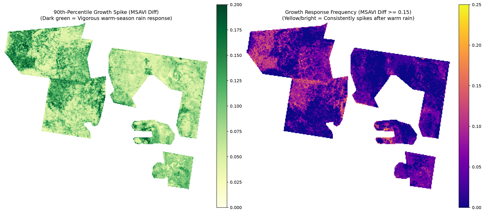
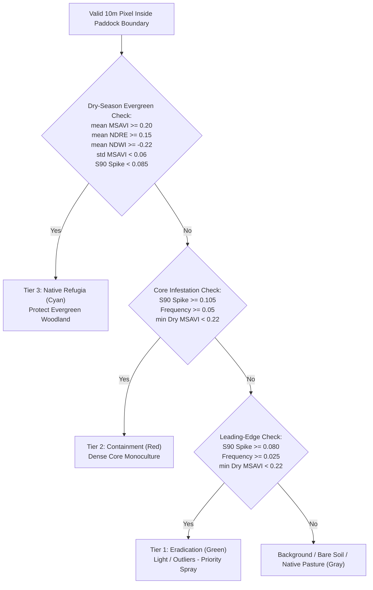
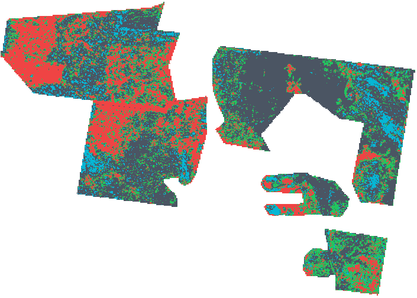

# 01. Ecology & Remote Sensing Methodology

**Navigation:** [[Home|Home.md]] | **01. Methodology** | [[02. Architecture & CLI|02-Pipeline-Architecture-and-CLI-Reference.md]] | [[03. Compilation|03-Compilation-and-Deployment-Guide.md]] | [[04. Field Validation|04-Field-Validation-and-Calibration-Protocol.md]]

---

## 1. Ecological Basis: Exploiting the $\text{C}_4$ Rain-Pulse Signature

Buffel grass (*Cenchrus ciliaris*) is a deep-rooted, drought-tolerant $\text{C}_4$ perennial tussock grass. Because single-date satellite imagery cannot reliably separate green grass from green native shrubs or cured grass from bare dirt, **`buffel-mapper`** isolates three distinct phenological behaviors:

1. **Rapid Warm-Season Green-Up (October–April):**
   - Following warm-season rainfall ($\ge 15\text{ mm}$), Buffel grass activates rapidly, reaching peak photosynthetic vigor within **12 to 28 days**.
   - By contrast, cold winter rain events (May–September) primarily stimulate $\text{C}_3$ winter annuals, medics, and herbage while $\text{C}_4$ Buffel grass remains largely dormant.
2. **14-Day Rain-Pulse Clustering & Dry-Baseline Filtering:**
   - Multi-day storm systems are grouped into **14-day rain-pulse clusters** so that consecutive wet days do not trigger redundant satellite queries or sample already-green grass as a "pre-rain" baseline.
   - For each rain pulse, only pixels that start from a dry baseline ($\text{Pre-Rain MSAVI} < 0.25$) are included in the frequency denominator.
3. **Dry-Season Senescence vs. Evergreen Refugia (August–November):**
   - Once soil moisture is depleted, Buffel grass cures into dry, non-photosynthetic straw ($\min \text{MSAVI} < 0.22$).
   - Native evergreen trees and woody shrubs (e.g., Mulga, Eucalyptus, Rosewood) retain stable canopy chlorophyll and leaf moisture year-round.

---

## 2. Spectral Indices & Cloud Mask Buffering

### A. 2-Pixel Cloud & Shadow Dilation
Sentinel-2 Scene Classification (`SCL`) flags opaque clouds (`8, 9`), cirrus (`10`), cloud shadows (`3`), and defective pixels (`0, 1`). Because thin cloud fringes and shadow edges often bleed 10–20 meters beyond the raw `SCL` flag, `buffel-mapper` applies a **2-pixel ($20\text{ m}$) morphological dilation** around all invalid `SCL` pixels prior to index calculation.

### B. Modified Soil-Adjusted Vegetation Index ($\text{MSAVI}$)
In semi-arid rangelands with exposed red soil, standard $\text{NDVI}$ suffers from soil-brightness distortion. $\text{MSAVI}$ dynamically self-adjusts for bare soil background:

$$\text{MSAVI} = \frac{2 \cdot \text{NIR} + 1 - \sqrt{(2 \cdot \text{NIR} + 1)^2 - 8 \cdot (\text{NIR} - \text{Red})}}{2}$$

* **Sentinel-2 Bands:** $\text{B08}$ ($\text{NIR}$, $10\text{ m}$) and $\text{B04}$ ($\text{Red}$, $10\text{ m}$).

### C. Normalized Difference Red-Edge Index ($\text{NDRE}$)
Sensitive to dense woody leaf chlorophyll in native tree canopies:

$$\text{NDRE} = \frac{\text{NIR} - \text{RedEdge}_1}{\text{NIR} + \text{RedEdge}_1}$$

* **Sentinel-2 Bands:** $\text{B08}$ ($10\text{ m}$) and $\text{B05}$ ($20\text{ m}$, bilinearly resampled to $10\text{ m}$).

### D. Normalized Difference Water Index ($\text{NDWI}$)
Sensitive to canopy liquid water content during prolonged dry spells:

$$\text{NDWI} = \frac{\text{NIR} - \text{SWIR}_1}{\text{NIR} + \text{SWIR}_1}$$

* **Sentinel-2 Bands:** $\text{B08}$ ($10\text{ m}$) and $\text{B11}$ ($20\text{ m}$, bilinearly resampled to $10\text{ m}$).

---

## 3. Targeted Rain-Pulse Metrics

Across all $N$ warm-season rain pulses over the 10-year archive, two lossless `float32` metrics are computed at every $10\text{ m}$ pixel:

1. **90th-Percentile Growth Spike ($S_{90}$):**
   $$S_{90}(y, x) = \text{Percentile}_{90}\Big(\big\{\Delta\text{MSAVI}_i(y, x)\big\}_{i=1}^{N}\Big)$$
   Using the 90th percentile instead of the raw maximum ($\max$) captures true drought-breaking growth capacity while rejecting single-scene sensor or cloud-edge anomalies.

2. **Growth Response Frequency ($F$):**
   $$F(y, x) = \frac{\sum_{i=1}^{N} \mathbb{I}\big(\Delta\text{MSAVI}_i \ge \tau \;\land\; \text{MSAVI}_{\text{pre}, i} < 0.25\big)}{\sum_{i=1}^{N} \mathbb{I}\big(\text{valid}_i \;\land\; \text{MSAVI}_{\text{pre}, i} < 0.25\big)}$$

---

## 4. 3-Tier Decision Tree Classification Rules

