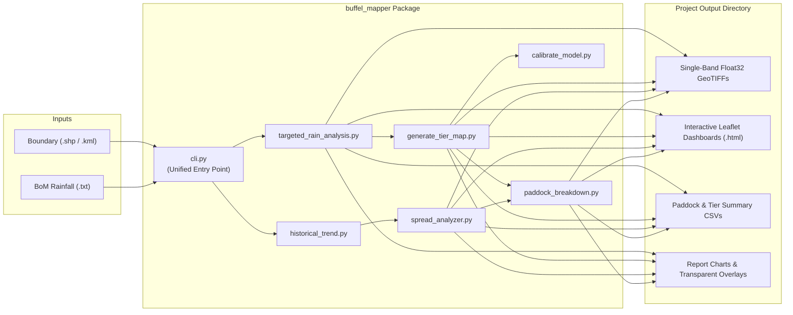

# 02. Pipeline Architecture & CLI Reference

**Navigation:** [[Home|Home.md]] | [[01. Methodology|01-Ecology-and-Remote-Sensing-Methodology.md]] | **02. Architecture & CLI** | [[03. Compilation|03-Compilation-and-Deployment-Guide.md]] | [[04. Field Validation|04-Field-Validation-and-Calibration-Protocol.md]]

---

## 1. End-to-End Architecture



---

## 2. CLI Subcommands

The `buffel-mapper` command-line interface supports running either the full end-to-end workflow or individual stages:

### A. `buffel-mapper run` (Full End-to-End Workflow)
Executes all 5 mapping stages sequentially in-process:

```bash
buffel-mapper run \
  --boundary /path/to/BSA.shp \
  --rain /path/to/rain_data.txt \
  --project Keewong_2026 \
  --projects-root ./projects \
  --index msavi \
  --threshold 0.15 \
  --buffer-pixels 2
```

| Flag | Default | Description |
| :--- | :---: | :--- |
| `--boundary`, `-b` | *Required* | Path to property boundary shapefile (`.shp`) or `.kml`. |
| `--rain`, `-r` | *Required* | Path to Bureau of Meteorology rainfall text file ($\ge 15\text{ mm}$). |
| `--project`, `-p` | *Required* | Name of the output project folder. |
| `--projects-root` | `projects` | Parent directory where project folders are stored. |
| `--index` | `msavi` | Spectral index (`msavi` or `ndvi`). |
| `--threshold` | `0.15` | Rain-pulse growth spike threshold for frequency counting. |
| `--max-cloud` | `10.0` | Maximum scene cloud cover percentage. |
| `--buffer-pixels` | `2` | Boundary buffer in 10m pixels ($2\text{ pixels} = 20\text{ m}$). |
| `--include-winter` | `False` | Include cool-season winter rain events (May–Sep). |
| `--skip-historical`| `False` | Skip the 10-year annual volatility scan if only rain-pulse & tiers are needed. |

---

### B. Individual Stage Subcommands

1. **Step 1 — Targeted Rain-Pulse Analysis (`targeted`):**
   ```bash
   buffel-mapper targeted \
     --kml /path/to/BSA.shp \
     --rain-file /path/to/rain_data.txt \
     --out-dir ./projects/Keewong_2026/targeted
   ```
2. **Step 2 — 3-Tier Weed Management Delineation (`tiers`):**
   ```bash
   buffel-mapper tiers --project ./projects/Keewong_2026 --buffer-pixels 2
   ```
3. **Step 5 — Paddock-by-Paddock Breakdown (`paddocks`):**
   ```bash
   buffel-mapper paddocks --project ./projects/Keewong_2026 --buffer-pixels 2
   ```
4. **Step 6 — Ground-Truthing Model Calibration (`calibrate`):**
   ```bash
   buffel-mapper calibrate \
     --csv-path /path/to/field_validation_points.csv \
     --project-dir ./projects/Keewong_2026 \
     --optimize
   ```

---

## 3. Output Directory Specification

Each project run generates a self-contained folder structure:

```text
projects/<Project_Name>/
├── BSA.shp (.shx, .dbf, .prj)            # Archived property boundary
├── rain_data.txt                         # Archived rainfall log
├── infestation_spread_map.png            # Decade centroid movement vector map
├── targeted/
│   ├── analyzed_rain_events.csv          # Log of matched Pre/Post Sentinel-2 scenes
│   ├── buffel_max_growth_spike.tif       # Single-band float32 90th-percentile MSAVI spike
│   ├── buffel_growth_frequency.tif       # Single-band float32 response frequency (0.0-1.0)
│   ├── targeted_analysis_report.png      # Side-by-side publication plot
│   └── keewong_targeted_weed_map.html    # Interactive Leaflet web map
├── tiers_layer/
│   ├── buffel_management_tiers.tif       # Single-band float32 GIS layer (1=T1, 2=T2, 3=T3)
│   ├── buffel_management_tiers.png       # Transparent EPSG:4326 RGBA overlay
│   ├── management_tier_statistics.csv    # Property-wide hectare summary
│   └── keewong_management_tiers_map.html # Interactive 3-Tier Leaflet dashboard
└── paddock_breakdown/
    ├── paddock_infestation_summary.csv   # Paddock-level Tier 1/2/3 & historical stats
    ├── paddock_comparison_chart.png      # Bar chart of infestation rates by paddock
    ├── paddock_historical_trend.png      # Decade time-series chart by paddock
    └── paddock_breakdown_map.html        # Interactive paddock popup map
```
