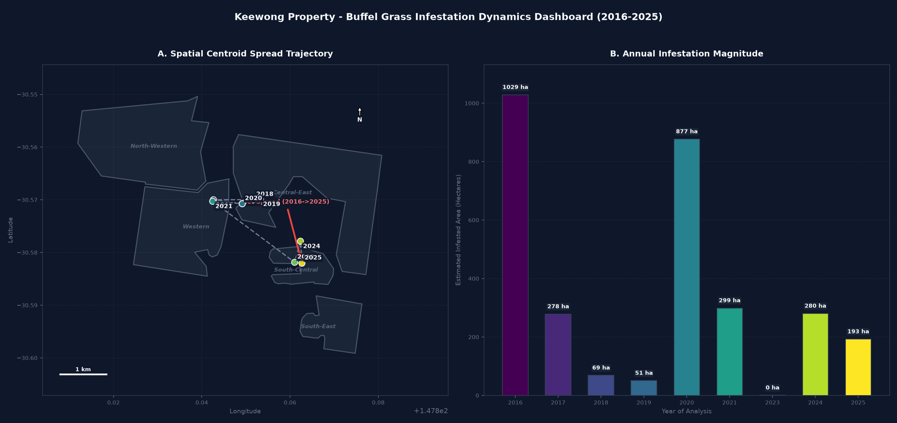

# Buffel Mapper Wiki — Home

Welcome to the **Buffel Mapper (`buffel-mapper`)** project wiki. This documentation covers the ecological foundations, satellite remote sensing math, software architecture, standalone Linux compilation, and field ground-truthing protocol used to map and manage Buffel grass (*Cenchrus ciliaris*).

---

## Wiki Table of Contents

| Page | Description |
| :--- | :--- |
| **[[01. Ecology & Remote Sensing Methodology\|01-Ecology-and-Remote-Sensing-Methodology.md]]** | How $\text{C}_4$ phenology, 14-day warm-season rain clustering, $\text{MSAVI}/\text{NDRE}/\text{NDWI}$ indices, and the 3-Tier decision tree work. |
| **[[02. Pipeline Architecture & CLI Reference\|02-Pipeline-Architecture-and-CLI-Reference.md]]** | System data flow, lossless `float32` GeoTIFF standards, CLI subcommands, and output specifications. |
| **[[03. Compilation & Deployment Guide\|03-Compilation-and-Deployment-Guide.md]]** | How to compile `buffel-mapper` into a standalone Linux executable (`dist/buffel-mapper`) with bundled `GDAL`/`PROJ` data. |
| **[[04. Field Validation & Calibration Protocol\|04-Field-Validation-and-Calibration-Protocol.md]]** | Standardized 5-meter field survey rules, GPS waypoint collection, and threshold calibration. |

---

## Visual Summary of Outputs

### 1. Rain-Pulse Growth Spike & Response Frequency

### 2. 3-Tier Operational Weed Management Map

### 3. Decade Invasion Spread Vectors (2016–2025)

